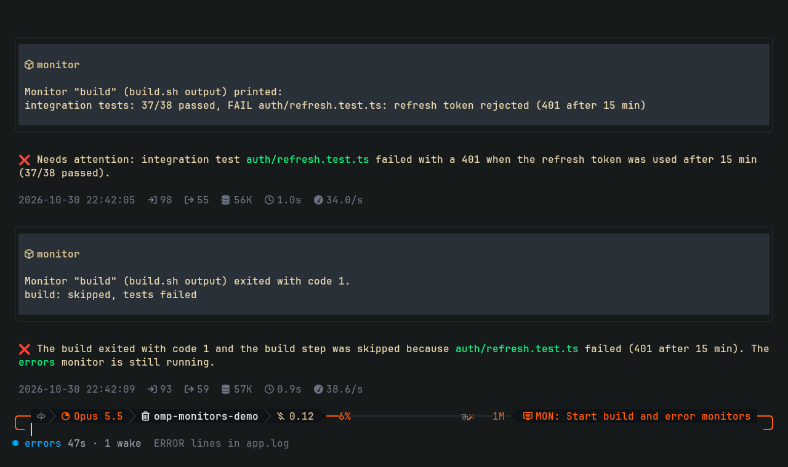
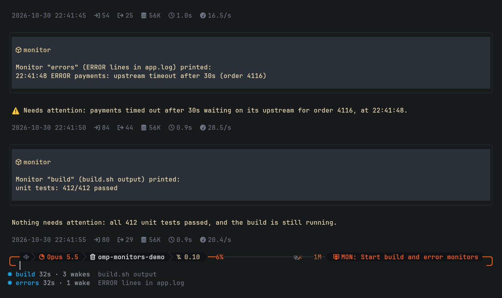

# omp-monitors

[](https://www.npmjs.com/package/omp-monitors)

Monitors for [oh-my-pi](https://github.com/can1357/oh-my-pi) (`omp`), like Claude Code's Monitor tool. The agent
starts a watcher command; every batch of lines it prints wakes the agent with those lines. The agent never
polls, never sleeps in a loop and never re-arms a watcher: it starts one and ends its turn.



- **`monitor` tool.** Starts a bash command in the background and returns at once. Each batch of output lines
  arrives as a message: it starts a turn when the agent is idle and queues behind the current run when it is
  busy.
- **Exit is news too.** When the command exits, the agent gets the exit code and the last lines, so a dead
  watcher is never silent.
- **Footer.** Running monitors are listed below the editor, one row each, with uptime and how many times
  they woke the agent.
- **`monitor_stop` tool and `/monitors` command.** Stop one (kills its whole process group) and list all
  monitors of the session.



## Install

```sh
omp install omp-monitors
```

Restart omp. Or from the [omp-extensions](https://github.com/Petyok/omp-extensions) marketplace:

```sh
omp plugin marketplace add Petyok/omp-extensions
omp install omp-monitors@omp-extensions
```

Use one of the two, not both. Requirements:

| | |
|---|---|
| omp | built and tested on 18.13.3 |
| Shell | `bash` on `PATH` (commands run as `bash -c`) |
| OS | Linux. macOS should work but is untested; Windows is not supported (process groups) |

## Use

Ask for it in plain words ("watch the deploy and tell me when it is done or fails"), or name the tool. Its
parameters:

| Parameter | Meaning |
|---|---|
| `name` | Unique short name, shown in the footer and in every message |
| `command` | bash command. Print one line per event and keep running |
| `description` | What it watches, shown in every message |
| `quietMs` | Deliver once the output has been quiet this long (default 2000) |
| `minIntervalMs` | At most one delivery per this interval (default 10000) |

A good watcher prints only what is news. Some shapes:

```sh
# a log: one line per error
tail -n0 -F app.log | grep --line-buffered ERROR

# Kubernetes: one line per pod phase change
kubectl get pods -w --no-headers

# anything that is polled: print only when the state changes, exit when done
prev=; while :; do s=$(gh run view 1234 --json status -q .status); [ "$s" != "$prev" ] && echo "$s" && prev=$s; [ "$s" = completed ] && exit; sleep 20; done
```

Output must reach the pipe line by line: use `grep --line-buffered`, `python -u`, or `stdbuf -oL`.

## How it works

- The command runs as `bash -c` in its own process group, with stdout and stderr read line by line.
- Lines are batched: a delivery goes out once the output has been quiet for `quietMs`, and at most once per
  `minIntervalMs`. One delivery carries at most 6000 characters; when a batch is longer, the newest output is
  kept and the message says how much was dropped.
- Deliveries are custom messages sent as follow-ups with `triggerTurn`: omp starts a turn when the session is
  idle and queues the message behind the current run when it is busy.
- `monitor_stop` kills the process group and drops output that was read but not delivered yet; nothing is
  delivered for a stopped monitor.
- Every monitor a session started is killed when the session shuts down. Subagents get their own set.

## Limits

- Monitors live in the omp process: they stop when omp exits and do not come back after a restart.
- Every delivery is a model turn and costs tokens. Watchers that print on every tick get expensive; print
  changes, not state.
- No stdin: commands that wait for input never get any.

## Develop

```sh
git clone https://github.com/Petyok/omp-monitors
omp install ./omp-monitors   # links the checkout; edits apply on the next omp start
bun test
```

## License

MIT.
